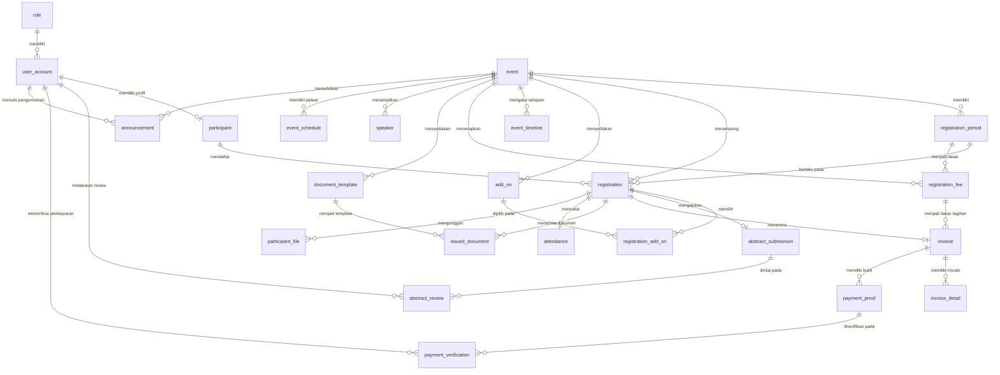

# Spesifikasi Basis Data & ERD (Entity Relationship Diagram)
## Sistem Informasi Kegiatan Seminar Internasional ASIC

---

## 1. Visualisasi Diagram ERD (Mermaid.js)

---

## 2. Struktur Spesifikasi Entitas & Atribut (23 Tabel)

### A. Entitas Akun dan Data Pengguna

#### 1. Tabel `role`
Menyimpan jenis peran pengguna dalam sistem.
- `id_role` (INT, PK, Auto Increment) - Identitas unik peran.
- `nama_role` (VARCHAR 30) - Peran: 'Peserta', 'Sekretariat', 'Bendahara', 'Tim Abstrak', 'Admin'.
- `deskripsi` (TEXT, Nullable) - Penjelasan tugas peran.

#### 2. Tabel `user_account`
Menggantikan tabel `users` default Laravel untuk otentikasi login.
- `id_user` (INT, PK, Auto Increment) - Identitas unik akun.
- `id_role` (INT, FK -> role.id_role) - Peran yang dimiliki pengguna.
- `email` (VARCHAR 100, Unique) - Alamat email untuk login.
- `password` (VARCHAR 255) - Hash kata sandi pengguna.
- `status_akun` (ENUM: 'Aktif', 'Nonaktif') - Status akun.
- `created_at` (DATETIME) - Tanggal akun dibuat.
- `updated_at` (DATETIME) - Tanggal akun diperbarui.

#### 3. Tabel `participant`
Menyimpan data identitas pribadi peserta seminar.
- `id_participant` (INT, PK, Auto Increment) - Identitas unik peserta.
- `id_user` (INT, FK -> user_account.id_user, Unique) - Akun pengguna peserta.
- `prefix` (VARCHAR 10) - Sapaan (Mr., Ms., Dr., Prof.).
- `first_name` (VARCHAR 50) - Nama depan.
- `last_name` (VARCHAR 50) - Nama belakang.
- `passport_no` (VARCHAR 30, Nullable) - Nomor paspor untuk peserta luar negeri.
- `job_title` (VARCHAR 100) - Pekerjaan/jabatan.
- `phone` (VARCHAR 20) - Nomor kontak/WhatsApp.
- `institution` (VARCHAR 150) - Nama institusi/universitas.
- `address` (TEXT) - Alamat lengkap.
- `city` (VARCHAR 100) - Kota asal.
- `country` (VARCHAR 100) - Negara asal.
- `postcode` (VARCHAR 15) - Kode pos.

---

### B. Entitas Informasi Kegiatan & Registrasi

#### 4. Tabel `event`
- `id_event` (INT, PK, Auto Increment)
- `nama_event` (VARCHAR 150) - Contoh: ASIC 2026.
- `tema` (VARCHAR 255) - Tema utama kegiatan.
- `deskripsi` (TEXT) - Deskripsi lengkap seminar.
- `tanggal_mulai` (DATE) - Tanggal pelaksanaan dimulai.
- `tanggal_selesai` (DATE) - Tanggal pelaksanaan berakhir.
- `lokasi` (VARCHAR 150) - Lokasi fisik acara.
- `mode_kegiatan` (ENUM: 'Hybrid', 'Daring', 'Luring')
- `status_event` (ENUM: 'Draft', 'Aktif', 'Selesai', 'Arsip')

#### 5. Tabel `registration_period`
- `id_period` (INT, PK, Auto Increment)
- `id_event` (INT, FK -> event.id_event)
- `nama_periode` (VARCHAR 50) - 'Early Bird', 'Regular', 'Late'.
- `tanggal_mulai` (DATE)
- `tanggal_selesai` (DATE)
- `status_periode` (ENUM: 'Aktif', 'Tidak Aktif')

#### 6. Tabel `registration`
- `id_registration` (INT, PK, Auto Increment)
- `id_participant` (INT, FK -> participant.id_participant)
- `id_event` (INT, FK -> event.id_event)
- `id_period` (INT, FK -> registration_period.id_period)
- `registration_type` (ENUM: 'Student', 'Regular', 'Committee')
- `attendance_mode` (ENUM: 'Daring', 'Luring')
- `participation_type` (ENUM: 'Oral Presenter', 'Poster Presenter', 'Listener')
- `publication_option` (ENUM: 'Prosiding', 'Jurnal', 'Tidak')
- `registration_date` (DATETIME)
- `registration_status` (ENUM: 'Terdaftar', 'Dibatalkan')

#### 7. Tabel `add_on`
- `id_add_on` (INT, PK, Auto Increment)
- `id_event` (INT, FK -> event.id_event)
- `nama_add_on` (VARCHAR 100) - Misal: Field Trip / City Tour.
- `deskripsi` (TEXT)
- `harga` (DECIMAL 12,2)
- `status` (ENUM: 'Aktif', 'Tidak Aktif')

#### 8. Tabel `registration_add_on`
- `id_registration` (INT, PKFK -> registration.id_registration)
- `id_add_on` (INT, PKFK -> add_on.id_add_on)
- `jumlah` (INT)
- `subtotal` (DECIMAL 12,2)

#### 9. Tabel `event_timeline`
- `id_timeline` (INT, PK, Auto Increment)
- `id_event` (INT, FK -> event.id_event)
- `nama_tahapan` (VARCHAR 100) - Misal: Batas Abstrak, Pengumuman.
- `tanggal_mulai` (DATE)
- `tanggal_selesai` (DATE)
- `deskripsi` (TEXT, Nullable)

---

### C. Entitas Abstrak & Seleksi

#### 10. Tabel `abstract_submission`
- `id_abstract` (INT, PK, Auto Increment)
- `id_registration` (INT, FK -> registration.id_registration, Unique)
- `judul_abstrak` (VARCHAR 255)
- `metode_presentasi` (ENUM: 'Oral', 'Poster')
- `file_abstrak` (VARCHAR 255) - Path file docx/pdf.
- `tanggal_submit` (DATETIME)
- `status_abstrak` (ENUM: 'Diajukan', 'Diterima', 'Ditolak')

#### 11. Tabel `abstract_review`
- `id_review` (INT, PK, Auto Increment)
- `id_abstract` (INT, FK -> abstract_submission.id_abstract)
- `id_reviewer` (INT, FK -> user_account.id_user) - Akun Tim Abstrak.
- `tanggal_review` (DATETIME)
- `hasil_review` (ENUM: 'Diterima', 'Ditolak')
- `catatan_review` (TEXT)

---

### D. Entitas Pembayaran & Dokumen

#### 12. Tabel `registration_fee`
- `id_fee` (INT, PK, Auto Increment)
- `id_event` (INT, FK -> event.id_event)
- `id_period` (INT, FK -> registration_period.id_period)
- `registration_type` (ENUM: 'Student', 'Regular', 'Committee')
- `attendance_mode` (ENUM: 'Daring', 'Luring')
- `amount` (DECIMAL 12,2)
- `discount` (DECIMAL 12,2, Default: 0)

#### 13. Tabel `invoice`
- `id_invoice` (INT, PK, Auto Increment)
- `id_registration` (INT, FK -> registration.id_registration, Unique)
- `id_fee` (INT, FK -> registration_fee.id_fee)
- `nomor_invoice` (VARCHAR 50, Unique)
- `tanggal_invoice` (DATETIME)
- `tanggal_jatuh_tempo` (DATE) - Batas 1 minggu sejak invoice terbit.
- `total_tagihan` (DECIMAL 12,2)
- `payment_qr_info` (VARCHAR 255) - Path/URL gambar QR statis dari panitia.
- `status_pembayaran` (ENUM: 'Menunggu Pembayaran', 'Menunggu Verifikasi', 'Terverifikasi', 'Ditolak', 'Kadaluwarsa')

#### 14. Tabel `payment_proof`
- `id_payment_proof` (INT, PK, Auto Increment)
- `id_invoice` (INT, FK -> invoice.id_invoice)
- `file_bukti` (VARCHAR 255) - Path file bukti transfer.
- `tanggal_upload` (DATETIME)
- `nominal_transfer` (DECIMAL 12,2)
- `catatan_peserta` (TEXT, Nullable)

#### 15. Tabel `payment_verification`
- `id_verification` (INT, PK, Auto Increment)
- `id_payment_proof` (INT, FK -> payment_proof.id_payment_proof)
- `id_treasurer` (INT, FK -> user_account.id_user) - Akun Bendahara.
- `tanggal_verifikasi` (DATETIME)
- `hasil_verifikasi` (ENUM: 'Valid', 'Tidak Valid')
- `alasan_penolakan` (TEXT, Nullable)

#### 16. Tabel `invoice_detail`
- `id_invoice_detail` (INT, PK, Auto Increment)
- `id_invoice` (INT, FK -> invoice.id_invoice)
- `jenis_biaya` (VARCHAR 100) - Misal: "Biaya Registrasi Main Event", "Add-on Field Trip".
- `deskripsi` (VARCHAR 255, Nullable)
- `jumlah` (INT)
- `harga_satuan` (DECIMAL 12,2)
- `subtotal` (DECIMAL 12,2)

#### 17. Tabel `document_template`
- `id_template` (INT, PK, Auto Increment)
- `id_event` (INT, FK -> event.id_event)
- `nama_template` (VARCHAR 100)
- `jenis_dokumen` (ENUM: 'Abstrak', 'Presentasi', 'Artikel', 'LOA', 'Penolakan', 'Invoice', 'Receipt', 'Sertifikat')
- `file_template` (VARCHAR 255)
- `tanggal_upload` (DATETIME)
- `status_template` (ENUM: 'Aktif', 'Tidak Aktif')

#### 18. Tabel `issued_document`
- `id_document` (INT, PK, Auto Increment)
- `id_registration` (INT, FK -> registration.id_registration)
- `id_template` (INT, FK -> document_template.id_template)
- `jenis_dokumen` (ENUM: 'LOA', 'Penolakan', 'Invoice', 'Receipt', 'Sertifikat')
- `nomor_dokumen` (VARCHAR 50)
- `file_document` (VARCHAR 255) - Path file PDF hasil generate.
- `tanggal_terbit` (DATETIME)

---

### E. Entitas Kehadiran & Berkas Peserta

#### 19. Tabel `attendance`
- `id_attendance` (INT, PK, Auto Increment)
- `id_registration` (INT, FK -> registration.id_registration, Unique)
- `qr_code` (VARCHAR 255) - String unik/token QR kehadiran.
- `tanggal_generate` (DATETIME)
- `tanggal_check_in` (DATETIME, Nullable)
- `status_kehadiran` (ENUM: 'Tidak Hadir', 'Hadir')

#### 20. Tabel `participant_file`
- `id_file` (INT, PK, Auto Increment)
- `id_registration` (INT, FK -> registration.id_registration)
- `jenis_file` (ENUM: 'Presentasi', 'Artikel')
- `nama_file` (VARCHAR 255)
- `file_path` (VARCHAR 255)
- `tanggal_upload` (DATETIME)
- `status_file` (ENUM: 'Diupload', 'Valid', 'Tidak Valid')

---

### F. Entitas Informasi & Komunikasi

#### 21. Tabel `speaker`
- `id_speaker` (INT, PK, Auto Increment)
- `id_event` (INT, FK -> event.id_event)
- `nama_speaker` (VARCHAR 100)
- `institusi` (VARCHAR 150)
- `negara` (VARCHAR 100)
- `foto` (VARCHAR 255)
- `deskripsi` (TEXT, Nullable)

#### 22. Tabel `event_schedule`
- `id_schedule` (INT, PK, Auto Increment)
- `id_event` (INT, FK -> event.id_event)
- `nama_kegiatan` (VARCHAR 150)
- `tanggal` (DATE)
- `waktu_mulai` (TIME)
- `waktu_selesai` (TIME)
- `lokasi` (VARCHAR 150)
- `deskripsi` (TEXT, Nullable)

#### 23. Tabel `announcement`
- `id_announcement` (INT, PK, Auto Increment)
- `id_event` (INT, FK -> event.id_event)
- `id_author` (INT, FK -> user_account.id_user)
- `judul` (VARCHAR 150)
- `isi_pengumuman` (TEXT)
- `tanggal_publikasi` (DATETIME)
- `status` (ENUM: 'Draft', 'Dipublikasikan')

---

## 3. Matriks Hak Akses Peran Pengguna (Role-Based Access Control)

| Modul / Fitur | Peserta | Sekretariat | Bendahara | Tim Abstrak | Admin |
| :--- | :--- | :--- | :--- | :--- | :--- |
| **Informasi Kegiatan & Narasumber** | Lihat | Kelola | Lihat | - | Kelola / Pantau |
| **Kelola Profil Sendiri** | Kelola | Kelola | Kelola | Kelola | Kelola |
| **Kelola Akun & Hak Akses Pengguna** | - | - | - | - | **Full CRUD** |
| **Pengajuan Pendaftaran & Add-on** | Buat & Lihat | Kelola | Lihat | Lihat | Pantau |
| **Pengumpulan Abstrak** | Kirim & Lihat | Lihat | - | Review & Seleksi | Pantau |
| **Seleksi Abstrak (Diterima/Ditolak)**| Lihat Hasil | Lihat Status | - | **Eksekusi Seleksi**| Pantau |
| **Penerbitan LOA & Invoice** | Download | Lihat | Kelola | - | Pantau |
| **Pemeriksaan Bukti Pembayaran** | Unggah Bukti| Lihat Status | **Verifikasi/Tolak**| - | Pantau |
| **QR Code Kehadiran & Check-in** | Lihat QR | **Scan QR** | Lihat Status | - | Pantau |
| **Unggah PPT & Artikel Lengkap** | Unggah | Kelola Berkas| - | - | Pantau |
| **Template Dokumen PDF** | - | Kelola | Kelola | Kelola Template | Kelola |
| **Rekapitulasi & Ekspor Excel** | - | **Ekspor Excel**| Lihat Pembayaran| Lihat Abstrak | Full Access |